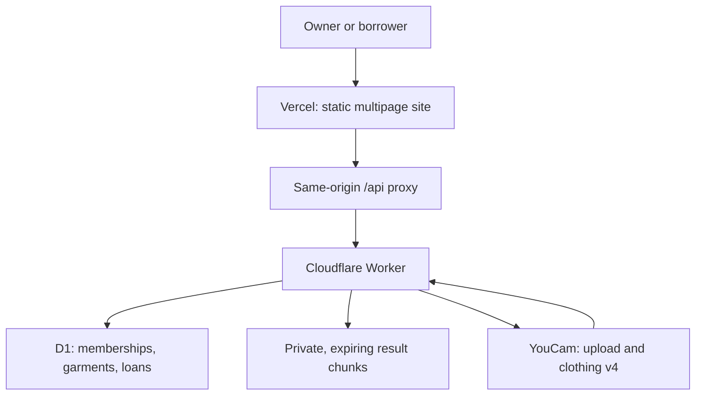
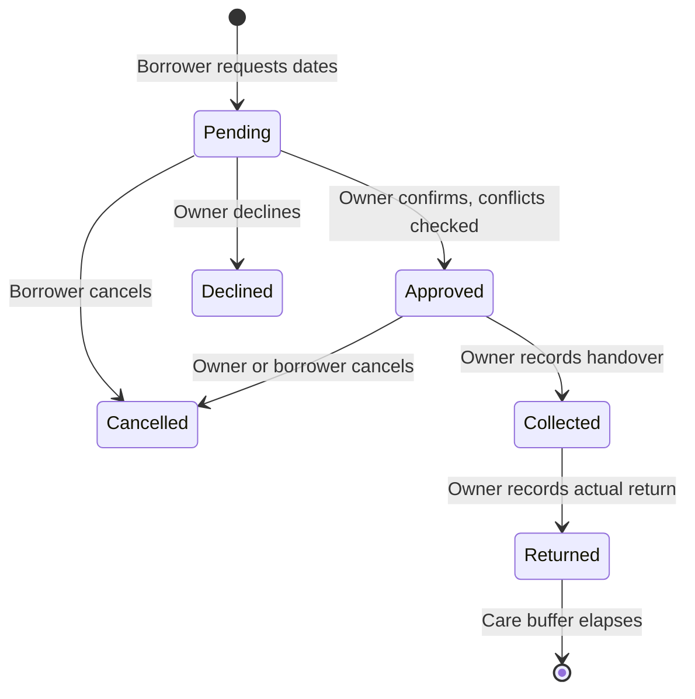

# Borrowloom

### Good pieces deserve another occasion.

Borrowloom is an invitation-only wardrobe for friends sharing occasionwear. It combines real borrowing dates and owner-controlled handovers with an optional private **YouCam clothing v4** visual preview.


**The useful part comes after the preview:** find a piece, read its actual measurements and condition, request a date window, receive the owner's approval, and track collection through actual return. Confirmed windows include a cleaning buffer. An overdue piece cannot silently become available again.

## Why this exists

Borrowing from a friend often means scattered photos, uncertain dates, and unspoken care arrangements. A generated outfit alone does not resolve those details. Borrowloom brings them into one private, structured workflow.

Clothing-rental research identifies assortment, availability, trust and practical processes as adoption barriers. Borrowloom narrows its audience to existing personal circles and occasional use. It does **not** claim measured adoption, avoided purchases, carbon savings or guaranteed physical fit. See [research and competitor analysis](docs/RESEARCH.md).

## What works

- Create an invitation-only wardrobe; add original garment photographs, size labels, actual measurements, condition and care instructions.
- Join through a private invitation. Owners can replace links and remove a member after active requests are resolved.
- Search and filter pieces; check inclusive borrowing dates with a fixed zero-to-three-day care buffer.
- Send a request, confirm or decline it, record collection, and record the actual return. Every successful transition has an audit event.
- Prevent overlapping confirmations in SQLite triggers, including adjacent cleaning time and overdue collection.
- Use a private browser account with a display name, single-use recovery codes, session revocation and JSON/CSV exports.
- Submit a consented portrait and garment to YouCam clothing v4, when the server credential is configured. Results are private to their initiating account, expire after 24 hours and can be deleted sooner.
- Explore a clearly labelled example wardrobe with fictional garments. It offers no real physical inventory.

**Integration status:** the provider adapter and its failure paths are implemented and tested with mocks. A live YouCam inference has **not yet been verified** because account activation is pending. Missing credentials explicitly disable preview; no image is fabricated or substituted. Borrowing remains independently usable.

## Architecture





No frontend framework, runtime npm dependency or client API key is required. Semantic HTML, native dialogs, original CSS and ES modules keep the site small and directly inspectable. Native system typography avoids remote font requests. The backend uses Web APIs and bound SQL statements.

## Run locally

Requirements: **Node.js 24 or newer**. Node's built-in SQLite is used by local development and tests.

```sh
npm install --ignore-scripts
npm test
npm run check
npm run build
npm run dev
```

Open `http://localhost:3080`. Development uses `.local/borrowloom.sqlite`, excluded from version control. It contains your local test records. A fresh browser gets an empty account; create a wardrobe or explore the explicitly labelled example.

To try live inference locally, set `YOUCAM_API_KEY` in your shell before running the development server. Keep it out of command history, screenshots and commits. `.env.example` documents the server variables; it contains no credential. The development server does not automatically load `.env` files.

## YouCam integration

1. Validate consent, identity, garment membership, image dimensions and bounded payload size.
2. Query the current API-unit balance and clothing-v4 SKU cost. Stop if the cost is ambiguous, exceeds the configured ceiling, or the balance reserve cannot be maintained.
3. Atomically reserve a daily/total allowance and record the idempotency key and non-reversible input digest.
4. Register and upload portrait and garment files. Never send the API Bearer key to signed storage URLs.
5. Create `/s2s/v2.0/task/cloth-v4` with strict single-person filtering and the garment category.
6. Poll no more often than the documented cadence. Pause after repeated service errors or a long wait; explicit rechecking retrieves the same task and does not start new inference.
7. Download the output from an allowlisted provider storage host into private bounded chunks, then request provider task deletion.

The original portrait is not stored in D1. Browser uploads are decoded, resized and re-encoded before transmission. The server performs bounded-format/dimension checks; it is not a full image decoder. A generated result is an illustration, not a physical-fit, colour-accuracy or medical assessment.

Default safeguards: at most 2 units per accepted SKU, a 500-unit balance reserve, 200 total reserved units, 30 per day, and 8 requests per account per day. These are application ceilings, **not a statement of current free credits**. Failed or ambiguous tasks conservatively consume their reservation; they are not automatically retried as new tasks.

References: [clothing v4](https://docs.perfectcorp.com/reference/ai_clothes/v4.0), [API unit balance and costs](https://docs.perfectcorp.com/reference/credit), [hackathon resources](https://youcam-api-skin-ai-ecommerce.devpost.com/resources).

## Deploy your own copy

1. Create a dedicated Cloudflare D1 database. Apply `src/schema.sql` to a **new** database. The migration files record changes made to the original development deployment; do not run them again after applying the current full schema.
2. Copy `wrangler.example.toml` to an untracked local configuration. Replace the D1 ID and trusted public origins with your own values.
3. Deploy `src/worker.mjs` and its local modules. Bind the database as `DB`. Set `YOUCAM_API_KEY` with Cloudflare's encrypted secret facility, never a plain text frontend variable.
4. Enable the hourly scheduled cleanup. It removes expired result chunks and rotates fairly through failed provider-deletion requests.
5. Set the external `/api/:path*` rewrite in `vercel.json` to your Worker hostname. Import the repository into Vercel: Node 24, `npm run build`, output directory `dist`.
6. Configure `SITE_ORIGINS` to the exact production origin and `ASSET_ORIGIN` to the same site. Keep preview deployments protected. Verify the cookie, actual image upload and booking journey on production before enabling inference.

Free-tier availability is subject to the providers' limits. This project does not enable a paid plan, payment collection, shipping or insurance. Production requires an operator to monitor quotas and the service's continued availability.

## Test and verification

`npm test` currently runs **32 tests** against actual SQLite constraints and a D1-compatible adapter. Coverage includes:

| Area | Evidence |
| --- | --- |
| Booking integrity | Overlapping approval, cleaning boundaries, early return, overdue hold, cross-wardrobe references |
| Authorization | Separate identities, owner/member permissions, private output isolation, revocation |
| Recovery | Single-use rotation, simultaneous claims, revocation of earlier sessions |
| Mutations | Idempotent requests, stale edits, archived-state action rules |
| Provider lifecycle | Duplicate task prevention, cancellation during upload/creation/download, signed-storage credential isolation |
| Operations | Bounded body size, rate limits, SKU/balance guards, polling pause/recheck, fair cleanup |
| Export | Secret exclusion, CSV formula neutralization |

Mocks verify protocol behavior, not YouCam image quality or a successful live integration. `npm run check` checks JavaScript syntax and a few credential patterns; it is not an independent penetration test or comprehensive secret scanner. Browser verification is recorded separately in `docs/VERIFICATION.md` once performed.

## Repository map

```text
public/             Browser modules, styles, icons and product assets
scripts/            Static build, local SQLite server and syntax checks
src/worker.mjs      Authorized API routes and scheduled cleanup
src/security.mjs    Sessions, recovery support, image and body boundaries
src/youcam.mjs      Real provider protocol, cost guards and job lifecycle
src/domain.mjs      Date, state-transition and validation rules
src/schema.sql      Fresh database schema, indexes and conflict triggers
tests/              Domain, storage, API, security and provider regressions
docs/               Product, technical, design and research decisions
```

## Current limits

Borrowloom coordinates people who already know each other. It does not verify identities or garment ownership, arbitrate damage, establish physical fit, charge deposits, handle shipping, or guarantee availability outside the recorded handover process. Full account deletion is not yet automated. Invitations and recovery codes are private bearer capabilities; anyone holding one has its corresponding access. Generated result access expires after 24 hours; provider-side deletion is requested and retried, not independently guaranteed.

The build has no measured user adoption or garment-borrowing impact study. Judge materials must distinguish observed behavior from future product plans. Live YouCam verification and event registration remain explicit release gates.

## Contribute

Please use a pull request, describe the user-visible change and run the relevant checks. Do not add secrets, user portraits, provider result URLs or real invitation/recovery codes to issues or commits. See [SECURITY.md](SECURITY.md).

## License and credits

Code: [MIT](LICENSE). Icons: Phosphor under MIT, obtained through Supericons. See [third-party notices and asset provenance](docs/ASSETS.md). Editorial clothing images were generated for this project; example garments are fictional and clearly labelled. They are not evidence of YouCam inference.

Built for the **YouCam API Skin AI & eCommerce VTO Hackathon**, Apparel VTO category. Final submission, demonstration video and image gallery are separate approval phases.
