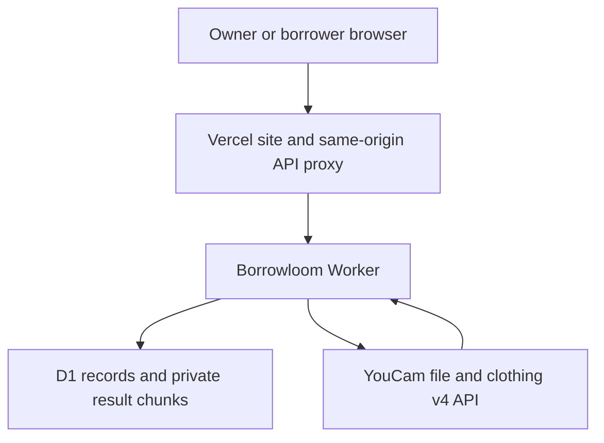

# Borrowloom technical design

## Architecture

Use semantic multipage HTML, original responsive CSS and small browser JavaScript modules. Vercel hosts static files and proxies `/api/*` to a dedicated Cloudflare Worker. A dedicated D1 database provides durable SQLite transactions. No paid infrastructure plan is enabled. This architecture avoids a new database subscription and isolates Borrowloom from existing projects.

## Identity and authorization

Create an opaque, random browser-session cookie; store only its SHA-256 digest in D1. Cookies are Secure, HttpOnly, SameSite=Lax and host-only. Session expiry is explicit. Each database query checks user membership or ownership. Invites are random bearer capabilities whose digests are stored; put invitation material in the URL fragment, remove it from the address after reading, and send it only in the join request. It must not appear in referrers or request logs.

Recovery codes restore an existing user through a guarded endpoint. Store digests only, never log the codes, and make rotation revoke earlier codes. No email/password credential is collected. This is an invitation-based guest identity model, not an assertion of email verification.

State-changing requests require a trusted Origin and application header. No credentialed cross-origin API is exposed. Database parameters are bound; text is escaped at rendering. Responses use no-store for private data and restrictive headers. Public health reports configuration readiness without keys or provider details.

## Data model

- `users`: display name, recovery digest and timestamps.
- `sessions`: token digest, user reference and expiry.
- `circles`: owner, title, lending rules, immutable care-day buffer, invite digest and example flag.
- `members`: circle/user relationship and display name.
- `garments`: circle, metadata, version, validated photograph, example asset reference and archive flag.
- `loans`: garment, borrower, inclusive collection/return dates, state, notes and actual return date.
- `loan_events`: actor and every successful state transition.
- `tryon_jobs`: initiating user, garment snapshot/version, idempotency digest, provider task, status, reserved units and expiry.
- `result_chunks`: bounded private binary result chunks, deleted with their job.
- `budgets`: atomic daily and total unit reservations.

Index membership lookups, garment/circle queries, blocking loan windows and user/job lookups. A database trigger rejects conflicting approved or collected loans, including cleaning windows. The API does not rely on a stale availability screen for correctness. Foreign keys retain circle/garment consistency.

## API contract

| Route | Purpose |
| --- | --- |
| `GET /api/session` | Create/read the current anonymous identity and memberships |
| `PATCH /api/session` | Update the current display name |
| `DELETE /api/session` | Sign out the current browser session |
| `POST /api/recovery` | Create/rotate a private recovery code |
| `POST /api/recover` | Restore an existing identity |
| `POST /api/circles` | Create an owned wardrobe, optionally using labelled example items |
| `GET /api/circles/:id` | Authorized wardrobe metadata, garments, availability and roles |
| `POST /api/join` | Join a wardrobe using its private invitation |
| `POST /api/circles/:id/invite` | Owner rotates an invitation |
| `POST /api/circles/:id/garments` | Owner adds a validated garment |
| `PATCH /api/garments/:id` | Owner edits a garment with version checks |
| `POST /api/garments/:id/archive` | Owner archives/restores a piece with active-loan guards |
| `DELETE /api/circles/:id/members/:userId` | Owner revokes a member after active requests are resolved and invalidates the old invitation |
| `GET /api/garments/:id/photo` | Authorized garment image |
| `GET /api/loans` | Own requests plus requests the user may manage |
| `POST /api/loans` | Idempotent date request |
| `PATCH /api/loans/:id` | Authorized transition, atomic conflict guard and event |
| `POST /api/tryons` | Consent, validation, budget reservation, upload and task creation |
| `GET /api/tryons/:id` | Session-authorized status, bounded provider polling |
| `POST /api/tryons/:id/recheck` | Explicitly recheck a paused existing task, without creating another |
| `GET /api/tryons/:id/image` | Session-authorized completed image, never a signed provider URL |
| `DELETE /api/tryons/:id` | Revoke result access and clean up provider task where supported |
| `GET /api/export` | Export the current user's accessible records without credentials or other users' portraits |
| `GET /api/health` | Readiness, with missing required configuration reported honestly |

## YouCam adapter

The official contract is file registration → signed upload → `POST /s2s/v2.0/task/cloth-v4` → periodic status checks → bounded result retrieval → finished-task deletion. Use `filter_multi_person: strict`, a matching supported garment category and no body reshaping. The API key is a Worker secret and never shipped in HTML, JavaScript, source control or logs.

Read feature cost and unit balance before a new task, reserve units atomically, and stop if the price or remaining balance breaches the configured free-unit budget. Creating a task uses a stable client idempotency key bound to user, garment version and image digest. A lost create response is uncertain and must not automatically start a replacement task. Poll no more often than the documented cadence. Time-bound every outbound call. Map known input errors into capture guidance.

Target and garment input URLs are not accepted from arbitrary clients. Upload bytes to the provider's registered signed destination; validate HTTPS hosts and do not forward the API Authorization header to storage. Validate the returned result URL and bounded image bytes. Persist results privately in small chunks; reject oversized output rather than silently truncating it.

Portrait input bytes are held only for processing, not added to the shared wardrobe. Result access expires; a scheduled cleanup deletes stored chunks and retries finished-provider-task deletion. The UI and privacy document must match the actual retention behaviour.

## Verification strategy

Use Node's test runner and a SQLite-backed D1 adapter for domain, route, database and provider-protocol tests. Include concurrent approval attempts, care-day boundaries, unauthorized sessions, stale versions, invalid images, malformed JSON, expired previews, cancellation rules, duplicate requests and unknown provider outcomes. Provider mocks prove protocol handling only; record live API observations separately after account access is authorized.

Use the connected browser to test both roles on the deployed site, mobile layouts, keyboard/dialog flows, refresh/recovery, exports, errors and public links. Inspect browser console messages. Do not claim a full independent penetration test or WCAG certification from these checks.
